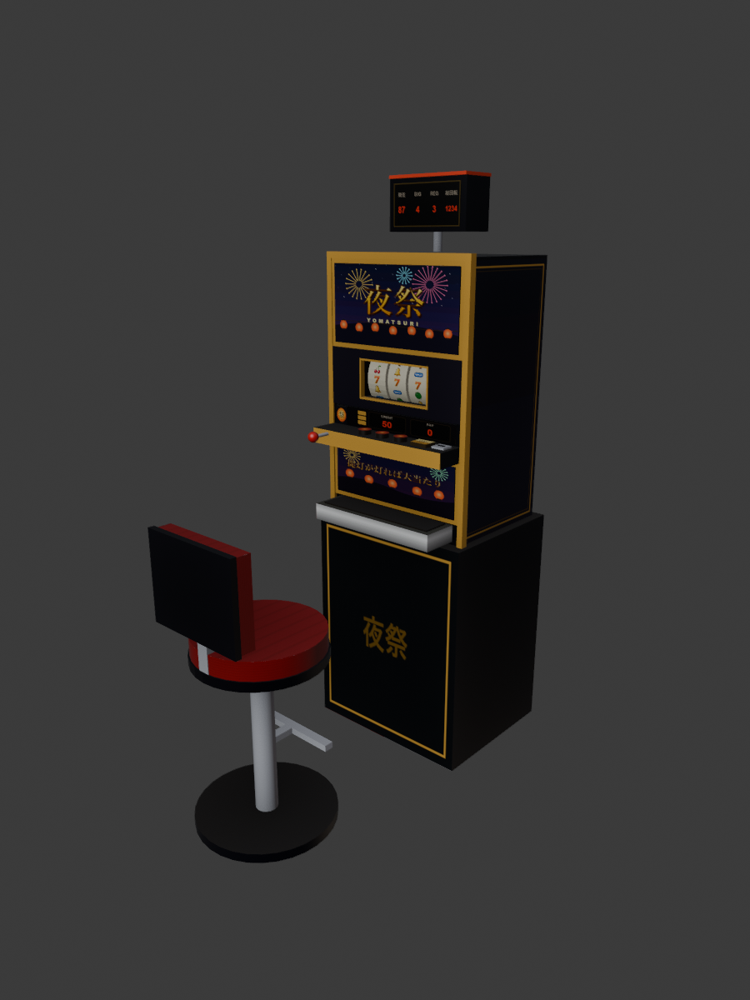
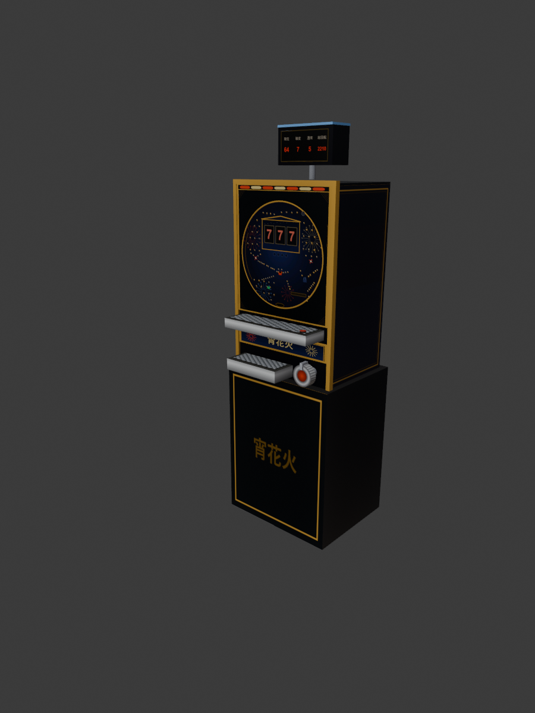
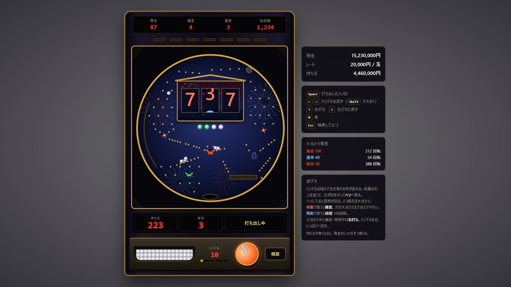
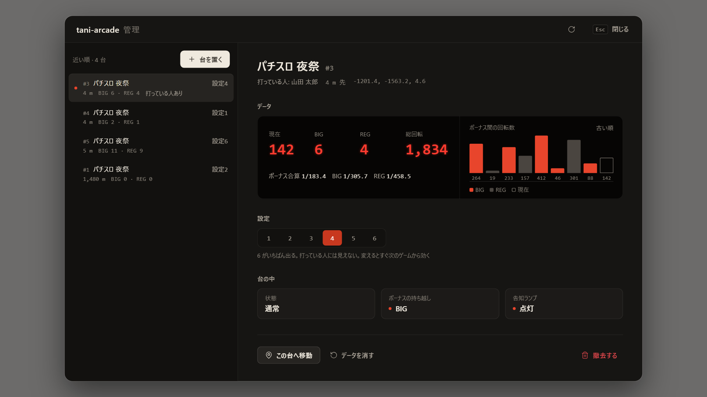
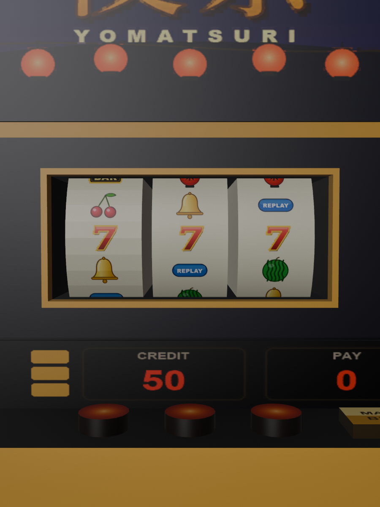

# ta-arcade（ゲームセンター）

街で遊べるゲームをまとめるリソース。今後のゲームや遊びはここに足していく（[ゲームの足し方](#ゲームの足し方)）。ゲームはパチスロ「夜祭」と、2026-11-14 に足した[パチンコ「宵花火」](#パチンコ宵花火)の 2 つ。2026-11-13 に tani-slot から tani-arcade に、同じ日に自作スクリプトの名前を揃えるため ta-arcade に改名した。

旧名（tani-arcade・tani-slot）のまま入れているサーバーは、古いフォルダを消してから入れ直し、`permissions.cfg` の ACE を `taArcade.admin` に書き換える。台の表は `ta_arcade_machines` になったが、起動した時にこの表が空なら、旧 `tani_arcade_machines`（無ければ旧 `tani_slot_machines`）から台を自動で写す（旧い表は消さない）。モデルの名前も `ta_slot_machine`・`ta_slot_chair`（ytyp は `ta_slot`）に変わった。

## パチスロ「夜祭」

Qbox サーバー向けのパチスロ。Blender で作ったスロット台と椅子（自作 prop）を管理者がゲーム内で並べ、プレイヤーは座って現金で打つ。メダル3枚掛け・3つのストップボタンで自分で止める（目押し）・BIG/REG のボーナスがある、ノーマルタイプの台。

> [!NOTE]
> **動作確認済み**
>
> FiveM の実機で動作を確認した。あわせて、サーバーの処理は疑似環境（fengari）で通しで確かめ、リール制御は全部の押し方を総当たりで調べた。画面はヘッドレス Chromium でキーを押して動きを確かめた。モデルは Sollumz で書き出したものを読み込み直して中身を確かめた。

## 遊び方

1. 台の前で ox_target の「スロットを打つ」を選ぶと椅子に座り、台の画面が開く。
2. スペースでレバー（掛けていなければ自動で3枚掛け）。メダル1枚 10万円、1ゲーム 3枚 = 30万円（これが最低 BET）。クレジットが無ければ現金から払う。
3. ← ↓ →（または 1 2 3、Z X C）で左・中・右のリールを止める。押し順は自由。
4. 揃った分はクレジットに入る。クレジットは50枚（500万円）まで。超えた分はその場で現金で受け取る。
5. Esc（または「精算」）でクレジットを現金に戻して席を立つ。

B で MAX BET、M で音の入り切り。台の前の「データを見る」で、その台の総回転・BIG・REG・現在の回転数・履歴が見られる（座らなくても見られる）。

### 役と配当

| 役 | 揃え方 | 配当 |
| --- | --- | --- |
| BIG | 赤7・赤7・赤7 | BIG ボーナス（払い出しが 252枚を超えるまで） |
| REG | 提灯・提灯・提灯 | REG ボーナス（96枚を超えるまで） |
| ベル | ベル×3 | 8枚（ボーナス中は 15枚） |
| スイカ | スイカ×3 | 6枚 |
| チェリー | 左リールにチェリー | 1ラインにつき 2枚（角に止まると 2ライン） |
| リプレイ | リプレイ×3 | 次のゲームを掛け金なしで回せる |

ラインは5本（上段・中段・下段・斜め2本）。1ゲームの払い出しは15枚まで。

### 告知ランプ（提灯）

ボーナスが当たると、台の左下の提灯ランプが灯る。灯るのはレバーを叩いた時（25%）か、3つ目のリールを止めた後（75%）。灯ったら赤7か提灯を狙って揃える。灯っている台は、周りの人にも提灯の明かりが見える。

## 仕組み

### 内部抽選とリール制御

レバーを叩いた時にサーバーが内部抽選をして「今回揃えてよい役」を決める。リールは押した位置から最大4コマ滑って止まり、その中で次の順に止まる位置を選ぶ。

1. 当たっていない役が揃わない位置
2. 当たっている役が揃いやすい位置
3. 滑りが少ない位置

選び方は `engine.lua` にあり、サーバーと画面（クライアント）が同じものを使う。画面は押した位置から止まる位置をその場で出して止め、3つ止めた後にサーバーが押した位置から同じ計算をやり直して払い出しを決める。

リール配列は、全部の押し方（押し順6通り × 押す位置 21³）を調べて次のようにした（`tests/test-engine.lua`）。

| 当たった役 | 適当に押して揃う割合 | 当たっていない役が揃った回数 |
| --- | --- | --- |
| ハズレ | - | 0 |
| リプレイ | 100% | 0 |
| ベル | 100% | 0 |
| チェリー | 95.2%（左リールを悪い所で押すとこぼす） | 0 |
| スイカ | 約38%（目押しが要る） | 0 |
| BIG | 約17%（目押しが要る） | 0 |
| REG | 約15%（目押しが要る） | 0 |

ボーナスは揃うまで次のゲームへ持ち越す。持ち越し中も小役の抽選はあり、小役が当たったゲームは小役が優先（ボーナスは揃わない）。チェリーとボーナスの同時当選もある。持ち越しとボーナスの途中経過は台に残るので、途中で席を立つと次に座った人が続きを打てる（サーバーを再起動すると消える）。

### 設定と払い出し率

台ごとに設定1〜6を管理者が決める（座る人には見えない）。払い出し率は `tests/rtp.js` で各設定150万ゲームを回した結果。

| 設定 | 適当押し | 目押し | BIG | REG | 1時間（600ゲーム）の収支の目安（適当 / 目押し） |
| --- | --- | --- | --- | --- | --- |
| 1 | 91.3% | 94.9% | 1/270 | 1/398 | -1,370万円 / -810万円 |
| 2 | 93.1% | 97.6% | 1/257 | 1/349 | -1,090万円 / -380万円 |
| 3 | 95.9% | 100.2% | 1/248 | 1/322 | -640万円 / +30万円 |
| 4 | 98.8% | 103.7% | 1/236 | 1/286 | -190万円 / +580万円 |
| 5 | 99.3% | 105.6% | 1/227 | 1/267 | -100万円 / +880万円 |
| 6 | 103.7% | 108.6% | 1/220 | 1/248 | +580万円 / +1,350万円 |

「目押し」は毎回いちばん良い所を押した場合で、人の上限にあたる。ボーナスの確率は揃った回数で数えている（同時当選を含む）。収支はメダル1枚 10万円（`Config.Slot.MedalPrice`、2026-11-13 にユーザーの指示で 100円から変更）の場合。1時間の収支は平均で、実際は1回の BIG（252枚超 = 約2,500万円）で大きく振れる。

> [!WARNING]
> **高額**
>
> 1ゲーム 30万円なので、設定5・6の台を目押しで打ち続けると 1時間に数百万〜1,000万円以上増える。街の経済に効くので、高設定の台の数は管理者が絞る。

### お金の流れ

- 掛け金はクレジットから引き、足りなければ足りない分を現金から引く（レバーを叩いた時にサーバーで）
- 払い出しはクレジットへ。50枚を超えた分はすぐ現金で渡す
- 精算・切断・リソースの停止のときは、残りのクレジットを現金で返す。回している途中で落ちたときは、順押しで止めたことにして払い出しも渡す。返すお金は citizenid 宛てに入れるので、ログアウト後でも届く
- 1ゲームの間隔は 4.1秒より短くできない（サーバーでも確かめる）

## パチンコ「宵花火」

2026-11-14 に足した 2 つ目のゲーム。玉を打ってまん中のヘソに入れると図柄が回り、3 つ揃うと大当たりになる。確変ループと時短のある台で、台と椅子の置き方・設定 1〜6・管理画面はパチスロと共通。椅子はパチスロと同じものを使う。

同じ日に、実際に打った感想（「これはパチンコなのか」）を受けて作り直した（3.2.0）。最初の版は、サーバーが玉の行き先をくじで決め、画面の玉はその結果に合わせて寄せていただけだった。今の版は、**サーバーが 1 発ごとに物理計算をして、玉が釘に当たって流れた結果として入賞が決まる**。ハンドルの強さ（ストローク）も自分で合わせる。

> [!WARNING]
> **作り直した版の実機は未確認**
>
> サーバーの処理は疑似環境（fengari）で通しで確かめ、画面はヘッドレス Chromium で動かして目で見た。モデルは Sollumz で書き出して確かめた。最初の版（3.1.0）は検証サーバーで打ったが、物理計算つきの今の版は FiveM の実機ではまだ動かしていない（[実機での確認](#実機での確認)に見る所を書いた）。

### 遊び方

1. 台の前で ox_target の「パチンコを打つ」を選ぶと椅子に座り、台の画面が開く。
2. ← →（または A D、マウスのホイール）でハンドルを回して、打つ強さ（0〜100）を合わせる。Shift を押しながらだと大きく回る。
3. スペース（またはハンドルのクリック）で打ち出しの入り切り。入れている間、0.6 秒に 1 発（1 分に約 100 発）打ち続ける。
4. 玉は 1 個 2 万円。持ち玉が無くなると、現金から 25 玉（50 万円）ずつ自動で借りる。現金が足りなければ打ち出しが止まる。
5. ヘソに入ると賞球 3 玉がもらえ、図柄が回る。回っている間に入った分は保留として 4 個までたまる。賞球は、玉が入賞口に届いた時に入る。
6. 大当たり中と確変・時短中は右打ち。↑ でハンドルを右いっぱい（92）へ、↓ で元の左打ちの強さへ戻せる。
7. Esc（または「精算」）で持ち玉を現金に戻して席を立つ。飛んでいる玉の賞球も一緒に受け取る。

M で音の入り切り。台の前の「データを見る」で、その台の総回転・確変と通常の回数・現在の回転数・履歴が見られる（座らなくても見られる）。左打ちの強さは次に座ったときも覚えている。

### ストローク（ハンドルの強さ）

玉は左の発射レールから外レールに沿って上へ飛び、強さによって落ちる所が変わる。

| 強さ | 玉の行き先 | ヘソに入る割合（通常時） |
| --- | --- | --- |
| 0〜4 | 外レールを上りきれず、左の端を落ちる | 1〜4% |
| 8〜12 | 左の寄り釘の外側に落ち、釘を伝って風車へ寄る | 6.5〜8%（いちばん回る。強さ 10 で約 8.2%、12 玉に 1 回） |
| 16〜20 | 寄り釘のまん中に落ち、散って外へ流れやすい | 2〜3% |
| 24〜36 | 液晶の左上（天釘の手前）に落ちる。寄り釘 → 風車 → 道釘 → ジャンプ釘 → 命釘と伝う（ぶっこみ） | 5〜6.5% |
| 40〜48 | 天釘と屋根に当たって散る | 約 3% |
| 52〜76 | 液晶の屋根を越えて右へ流れる | 1% 以下 |
| 78 以上 | 右上の返しゴムに当たって右側へ落ちる（右打ち） | 0.5% ほど |

数字は `node tests/pachi-rates.js 20000`（強さごとに 2 万玉）で測ったもの。同じ強さでも、打ち出しのむら（速さ ±2.5%）と釘への当たり方で、毎回ちがう流れ方をする。座った時のハンドルは 32 から始まるので、どの強さがいちばん回るかは打ちながら探す。

右打ちは、確変・時短中の電チューに約 55%、大当たり中のアタッカーに約 97% 入る（強さ 88〜96）。

打つ向きが状態に合っていないと、画面の下に「右打ちしてください」「左打ちに戻してください」が出る（通常時に右へ打つと、電チューもアタッカーも閉じているので全部アウトになる）。

### 盤面

| 部品 | 働き |
| --- | --- |
| 天釘 | 液晶の左上の 4 本。落ちてきた玉を散らす |
| 寄り釘 | 左側に互い違いに打った釘。玉を散らしながら風車へ寄せる |
| 風車 | 当たった玉を左右へ弾く。左へ弾かれた玉は外へ、右へ弾かれた玉は道釘に乗る |
| 道釘 | 風車の下からヘソへ向かう右下がりの列。途中の 2 本（6 番と 9 番）を抜いてあり、そこから玉がこぼれる。ヘソへの入りやすさは、このこぼしの数と場所でいちばん大きく変わる |
| ジャンプ釘・命釘 | 道釘の終わりの 1 本と、ヘソの上の 2 本。勢いのある玉はジャンプ釘で跳ねて命釘の間を通り、遅い玉は手前のすき間から落ちる。命釘の間隔（16.2。玉の直径は 14）を 14.6〜16.2 で変えても、入る割合はほとんど変わらなかった |
| 液晶の屋根 | 山形。乗った玉は左右へ転がる |
| 返しゴム | 右上。強く打った玉が当たって右へ落ちる |
| 電チュー | 右。確変・時短中だけ羽根が開く。閉じているときは玉を弾く |
| アタッカー | 右下。大当たり中だけ開く。閉じているときは盤面と面一で、玉は前を素通りする |
| 一般入賞口 | 左下。左右の釘の間を通った玉だけが入る（賞球 5 玉。めったに入らない） |

並びは `shared/pachi_board.lua` に 1 か所だけ書いてあり、サーバーの物理計算・台の画面・台のテクスチャが同じものを使う。

### 図柄と演出

図柄は 1〜9 の 3 列で、上から下へ流れて、左・右・中の順に止まる。演出の種類も、当たり外れと一緒にサーバーが決める。

| 演出 | 中身 |
| --- | --- |
| 保留の色（先読み） | 保留の玉が白・緑・赤に変わる。当たりの保留は色が変わりやすいが、ハズレでもまれに変わる |
| 予告 | 変動が始まる時に「チャンス」「熱」「激熱」が出る。強いほど当たりやすい |
| ノーマルリーチ | 左右が揃い、中の列がゆっくり流れる |
| スーパーリーチ | リーチから発展する。変動が長く、当たりの時はここを通ることが多い |
| 全回転 | 3 列が同じ図柄のまま流れる。出れば必ず当たり |

### 大当たりの流れ

| 状態 | なり方 | 中身 |
| --- | --- | --- |
| 大当たり | 図柄が 3 つ揃う | 右下のアタッカーが開く。1 ラウンドは 9 個目の玉が届くまで、1 個で賞球 15 玉。閉じる前に届いた玉は、数を超えていても入る（オーバー入賞）。ラウンド数は当たったときに決まる（下の表） |
| 確変 | 奇数の図柄で揃った大当たりの後 | 次の大当たりまで、当たる確率が 1/40 になる。電チューが開く（賞球 2 玉） |
| 時短 | 偶数の図柄で揃った大当たりの後 | 100 回転の間、電チューが開く。当たる確率は通常のまま |

大当たりのうち確変になるのは 50%。大当たり中と確変・時短中は右打ち（自分でハンドルを回す）。

| 当たった入賞口 | 4 ラウンド（賞球 約 540 玉） | 10 ラウンド（賞球 約 1,350 玉） |
| --- | --- | --- |
| ヘソ（通常時） | 80% | 20% |
| 電チュー（確変・時短中） | 60% | 40% |

大当たり中・確変中・時短中の台は、上のランプが灯り、周りの人にも明かりが見える。途中で席を立つと、保留・変動・大当たり・確変と時短はそのまま台に残り、次に座った人が続きを打てる（サーバーを再起動すると消える）。

### 設定と払い出し率

台ごとに設定 1〜6 を管理者が決める（座る人には見えない）。設定で変わるのは通常時の大当たり確率だけで、ヘソへの入りやすさ（釘）はどの台も同じ。払い出し率は「打った玉に対して戻ってくる玉」の割合で、`tests/pachi-rtp.js` で計算した。

| 設定 | 大当たり確率（通常時） | 払い出し率 | 連チャンの平均 | 初当たりまでに使う平均 | 1 時間の収支の目安 |
| --- | --- | --- | --- | --- | --- |
| 1 | 1/280 | 約 92% | 2.86 回 | 約 5,150 万円 | -970 万円 |
| 2 | 1/271 | 約 94% | 2.89 回 | 約 4,990 万円 | -680 万円 |
| 3 | 1/261 | 約 97% | 2.94 回 | 約 4,800 万円 | -330 万円 |
| 4 | 1/251 | 約 100% | 2.98 回 | 約 4,620 万円 | +40 万円 |
| 5 | 1/243 | 約 103% | 3.02 回 | 約 4,470 万円 | +370 万円 |
| 6 | 1/235 | 約 106% | 3.06 回 | 約 4,320 万円 | +720 万円 |

初当たり 1 回（連チャンを含む）の出玉は平均で約 4,450〜4,780 万円。払い出し率は、測るたびに ±1% ほど動く（いちばん回る強さの選ばれ方と乱数のぶれ）。式で出した値を、同じ割合で 600 万玉を打ちっぱなしにした値と 2 回（12 通り）比べたところ、差は最大 4.4% で、打ちっぱなしの方が平均で 1.4% ほど低かった。600 万玉でも ±2% ほどぶれるので式の誤りとは言い切れないが、実際の払い出し率は表より 1〜2% 低いかもしれない。

前提は「通常時はいちばん回る強さで左打ち、大当たり中と確変・時短中は右打ち、1 時間ずっと打ちっぱなし（6,000 発）」。ストロークが合っていなければ、この表より回らず、払い出し率は下がる（たとえば強さ 32 のぶっこみだと、ヘソに入る割合は 3 割ほど少ない）。大当たりは回数が少ないので、実際の収支は 1 時間で数千万円の幅で振れる。

計算のしかたは 3 段階（`node tests/pachi-rtp.js`）。まず物理計算で玉を打って入賞の割合を測る（左打ちはいちばん回る強さを探す）。次に、その割合で長い時間を打ちっぱなしにして、ぶれの小さい数字（1 回転あたりの玉数、玉 1 個あたりの賞球、大当たり 1 回で打つ玉数）を測る。連チャンの回数は式で出す。大当たりは回数が少なく、打つだけの計算では設定ごとの差が乱数のぶれに埋もれるため。`check` を付けると打ちっぱなしの結果も並べ、式と大きくずれていないことを確かめられる。

> [!WARNING]
> **高額**
>
> 1 分で最大 200 万円を使い、大当たり 1 回で 1,000 万〜2,700 万円が戻る。設定 5・6 の台は打ち続けると増えるので、高設定の台の数は管理者が絞る。

### 仕組み

- **玉の動きはサーバーが計算する**: 1 発ごとに、サーバーが玉を打ち出しから入賞口かアウト口まで動かす（`server/pachi_physics.lua`）。使うのは重力と、釘・風車・返しゴム・液晶と屋根・外レール・閉じた電チューへの衝突だけで、行き先を決めるくじは引かない。1 歩は 1/600 秒
- **画面は軌道を再生する**: サーバーは玉の位置を 1 秒に 50 点の軌道として返し、画面はそれをなぞる。釘に当たった点も一緒に返るので、そこで音を鳴らし、風車を回す。画面の側では物理計算をしない
- **クライアントから受け取るのは「打つ」と「ハンドルの強さ」だけ**: 強さはサーバーで 0〜100 の整数に直す。打ち出しのむらの乱数もサーバーで引く
- **賞球と保留は、玉が届いた時刻に入る**: 飛んでいる玉はサーバーが覚えていて、届く時刻になったら賞球を持ち玉に入れ、保留を足す
- **アタッカーは時刻で開閉する**: 玉を打った時に、その玉がアタッカーに届く時刻が分かるので、その時刻に開いているかで入るかどうかを決める。ラウンドは 9 個目の玉が届く時刻に閉じ、その前に届く玉は数を超えていても入る
- **当たり外れは変動が始まるときに決める**: 保留には抽選の乱数だけを入れ、確変中かどうかは変動が始まる時の状態で見る。保留の色（先読み）は、入った時点の確率で当たりかどうかを見て付ける
- **状態は時刻で進む**: 玉の到着・変動の終わり・大当たりの終わりは、サーバーが時刻の順に処理する。打っている間は 1 発ごとの返事に、打っていない間は「次の玉が届く時刻」か「変動が終わる時刻」に 1 回だけ問い合わせて続きを受け取る

### お金の流れ

- 玉を借りるお金は、打つときにサーバーが現金から引く。引けたときだけ玉を渡す
- 賞球は、玉が入賞口に届いた時に持ち玉へ入る。持ち玉は 2,500 玉（5,000 万円）まで。超えた分はすぐ現金で渡す
- 精算・切断・キャラクターの切り替え・台から離れたとき・リソースの停止のときは、残りの持ち玉と、飛んでいる玉の賞球を現金で返す。返すお金は citizenid 宛てに入れる。飛んでいた玉は盤面に残り、届けば保留にはなるが、賞球を二重には渡さない
- 持ち玉と持ち主は台のデータに控え、60 秒ごとに DB へ書く。サーバーが落ちて精算できなかったときは、次の起動で持ち主に返す（失うのは最大で直近 60 秒分）
- 打ち出しの間隔は 0.6 秒より短くできない（サーバーで確かめる。少し早く届いた分は許すが、平均では速くならない）

## 管理者の操作

`/arcadeadmin` で管理画面を開く（ACE `taArcade.admin` が要る）。台の前の ox_target の「台の管理」からは、その台を選んだ状態で開く。

- **台の一覧**（左）: 近い順に並ぶ。朱の点はランプが灯っている台（パチスロはボーナスの持ち越し、パチンコは大当たり中・確変中・時短中）
- **台の詳細**（右）: データカウンター（パチスロは現在・BIG・REG・総回転と確率、パチンコは現在・確変・通常・総回転）、当たりと当たりの間の回転数の棒（BIG と確変は朱、REG と通常は灰、現在は枠だけ）、設定 1〜6、台の中の状態（パチスロは通常かボーナス中か・持ち越し・ランプ、パチンコは状態・保留・変動）
- **未払い**（上）: 払い戻せずに残っているお金があるときだけ、件数と合計が出る（[払い戻しに失敗したとき](#払い戻しに失敗したとき)）
- **この台へ移動**・**データを消す**・**撤去する**。消すと撤去は 3 秒以内にもう一度押すと実行する
- **台を置く**: ゲームと設定を選んで「設置を始める」と画面を閉じて設置モードになる。見ている場所に台と椅子の半透明の見本が出る。マウスで場所、ホイールか Q・E で向き（Shift で細かく）、Enter で置く（続けて何台でも）、Backspace で終わると管理画面に戻る
- **隣の台にそろえる**: 設置モードで既にある台に近づけると、その台の右か左にぴったり並ぶ（G で入り切り）。島を作るときに使う

### 打っている時の管理パネル

管理者がスロットに座ると、台の左に管理パネルが出る（ほかの人には出ない）。

- **確実に当たり**: 切・BIG・REG。入れると、通常時のレバーごとに抽選をせずにそのボーナスが当たり、告知ランプがすぐ灯り、どこで押しても揃う（押した位置から揃う位置までリールが回ってから止まる）。ボーナス中は普段どおり。台を離れると切に戻る。当たった分はデータカウンターにも数える
- **設定**: その場で 1〜6 を変えられる。次のゲームから効く
- **台の中**: 状態・持ち越し・ランプ

パチンコに座ったときも同じ場所にパネルが出る。**確実に当たり**は切・確変・通常で、入れると通常時の変動が抽選なしでその大当たりになる（確変・時短中は普段どおり）。**設定**と**台の中**（状態・保留・変動）も同じ。

### 払い戻しに失敗したとき

お金を返すとき（精算・切断・あふれた分の現金化など）に qbx_core が受け取りを断った場合は、`ta_arcade_unpaid` 表に citizenid・金額・理由を残す。残した分は、その人が次に台に座ったときと、リソースの起動時に払い直す。払い直すときは先に行を消し、消せたときだけ払うので、二重には払わない。残っている間は管理画面の上に件数と合計が出る。どのゲームもこの仕組み（`Arcade.pay`）を通る。

### キャラクターの切り替え

切断せずにキャラクターを切り替えたとき（qbx_core の `QBCore:Server:OnPlayerUnload`）も、座っていた台を精算して席を空ける。画面も閉じる。

### 置き場所

台は DB（`ta_arcade_machines`。ゲームの種類・位置・設定・データカウンターの JSON）に保存し、次の起動でも同じ場所に出る。新しい表が空のときは、旧 tani-arcade の `tani_arcade_machines`、それが無ければ旧 tani-slot の `tani_slot_machines` から一度だけ写す（旧い表は消さない。tani-arcade の表があれば、0 台でもそちらを正とする）。台は各プレイヤーの画面の中だけに作る（ネットワークの物体にしない）ので、何台置いてもサーバーの負担にならない。80m より遠い台は消している。

## 導入

1. このフォルダを `resources/[standalone]/ta-arcade` に置く（`design/`・`blender/`・`tests/` は入れなくてよい）
2. `permissions.cfg` に `add_ace group.admin taArcade.admin allow`
3. DB の表は起動時に自動で作る（手で作るなら `install/ta_arcade.sql`）
4. `ensure [standalone]` で読み込まれる

DB の表は `ta_arcade_machines`（台）と `ta_arcade_unpaid`（払い戻せなかったお金の控え）の 2 つ。アイテムは使わないので ox_inventory の追加はない。必要なものは ox_lib・ox_target・oxmysql・qbx_core・okokNotify（通知）。

## ゲームの足し方

1. `config.lua` の `Config.Games` に 1 つ足す（表示名・モデル・椅子・椅子の位置・並べる間隔・設定の有無）と `Config.GameOrder`
2. `server/<ゲーム>.lua` で `Arcade.registerGame(名前, { emptyData, init, lamp, publicData, adminState, onDrop, onStop, warmup })` を呼ぶ。遊ぶ処理（コールバック）もこのファイルに書く。お金を渡すときは `Arcade.pay(citizenid, 円, 理由)` を使う
3. `client/<ゲーム>.lua` で `ArcadeClient.registerGame(名前, { targetOptions, lampLight, warmup, forceClose })` を呼ぶ
4. 管理画面の見せ方を `html/admin.js` の `GAMES` に足す（一覧の 1 行・データの数字・台の中の状態）
5. `fxmanifest.lua` に足す（サーバーは `server/start.lua` より前）。モデルは `stream/` と ytyp

台の置き場所・管理画面・設置モード・データの保存・払い戻しの控えは共通なので、ゲームごとに作らなくてよい。

## ファイル

| ファイル | 中身 |
| --- | --- |
| `config.lua` | 共通（権限・コマンド・ゲームの一覧）、パチスロ（値段・抽選値・ボーナス・座る位置・ランプの光）、パチンコ（値段・確率・賞球・ラウンド・演出の割合・時間） |
| `shared/slot_engine.lua` | リール配列・ライン・役・リール制御（サーバーとクライアント共通） |
| `server/main.lua` | 共通: 台の情報、管理者の操作、ゲームの登録口、お金を渡す処理（`Arcade.pay`）と未払いの払い直し |
| `server/slot.lua` | パチスロ: 内部抽選、払い出し、お金、確実に当たり |
| `shared/pachi_board.lua` | パチンコの盤面: 釘・風車・役物・入賞口の並び（サーバーの物理計算・台の画面・テクスチャが共通で使う） |
| `server/pachi_physics.lua` | パチンコ: 玉 1 個の物理計算（重力と衝突。FiveM の関数を使わない） |
| `server/pachi_engine.lua` | パチンコ: 飛んでいる玉、保留、図柄の抽選と演出、ラウンド、時刻で進む状態（FiveM の関数を使わない） |
| `server/pachi.lua` | パチンコ: 打ち出し、持ち玉とお金、確実に当たり |
| `server/start.lua` | 起動: 表を作る、旧名（tani-arcade・tani-slot）の引き継ぎ、台の読み込み、未払いの払い直し |
| `client/main.lua` | 共通: 台と椅子を置く、ox_target、管理画面、設置モード、ランプの光 |
| `client/slot.lua` | パチスロ: 座る、台の画面とのやり取り、データを見る |
| `client/pachi.lua` | パチンコ: 座る、打っている間の問い合わせ、台の画面とのやり取り |
| `html/` | パチスロの画面（`app.js`・`style.css`）、パチンコの画面（`pachi.js`・`pachi.css`）、管理画面・管理パネル（`admin.js`・`admin.css`） |
| `stream/` | `ta_slot_machine.ydr`・`ta_slot_chair.ydr`・`ta_slot.ytyp`、`ta_pachi_machine.ydr`・`ta_pachi.ytyp`（Sollumz で書き出したもの） |
| `design/` | 図柄とパネルの絵（`gen.js` で SVG → `render.py` で PNG）、パチンコの画面の見本用の軌道（`pachi_sample.js`。リソースには入れない） |
| `blender/` | 共通の道具（`common.py`）、パチスロのテクスチャ（`make_textures.py`）とモデル（`build_models.py`）、パチンコのテクスチャ（`make_pachi_textures.py`）とモデル（`build_pachi.py`）、`ta_slot.blend`・`ta_pachi.blend`（データだけを相対パスで保存。PC のパスは入らない）、確認用の描画 `preview/` |
| `tests/` | 構文チェック、サーバーの疑似環境テスト（パチスロ・パチンコ）、リール制御の総当たり、払い出し率（パチスロ・パチンコ）、画面の操作テスト |

### 管理画面の見た目

unslop の手順で作った。方向は「夜祭の帳場」: 面は暖かい黒（`#161513` など）、差し色は提灯の朱だけ（白い文字を載せる面は `#c8381f`、点と棒は `#e8452c`）。見せ場は台と同じ赤い数字のデータカウンターとボーナス間の回転数の棒、しるしは朱の小さな点（ランプが灯っている台）。間隔は 4px 刻み、文字の太さは 400/500、アイコンは lucide の線画（16px・線幅 1.5）。光らせる効果は付けていない（データカウンターの数字だけは台に合わせて少し光らせている）。

### モデルを直すとき

1. 絵を直すなら `node design/gen.js` → `py -3 design/render.py design/svg design/png`（画面用は `html/img/` にもコピー）
2. `py -3 blender/make_textures.py`（アトラスとリール帯の DDS。リール帯は `shared/slot_engine.lua` の配列から作る）
3. `blender --background --python blender/build_models.py`（Blender 5.3 は PATH に無いのでフルパスで呼ぶ）。`stream/` に書き出し、`blender/preview/` に描画する

台の正面は -Y、原点は床の中心。台の高さは 1.89m（データカウンター込み）、椅子の座面は 0.63m。材質は本体（default.sps）、光る面（emissive.sps）、リール（emissive.sps、弱め）の3つで、テクスチャは ydr に埋め込んでいる。コリジョンは箱（台2つ・椅子2つ）。Sollumz の依存（szio・PyMateria）は 2026-11-13 に入れた。

パチンコの釘を直したときは、次の順に作り直す（`tests/` で実行）。

1. `node pachi-rates.js` で、ハンドルの強さごとの入賞の割合を測る。玉の流れを絵で見るなら `node lua-run.js pachi-export.lua paths 25 40 > paths.json` → `py -3 pachi-draw.py paths.json out.png`
2. `node pachi-rtp.js` で払い出し率を出す。最後の行に「目標に合う大当たり確率」が出るので、`config.lua` の `Config.Pachi.HitChance` を合わせ、README の表を直す
3. `node lua-run.js pachi-export.lua sample > ../design/pachi_sample.js`（画面の見本用の軌道）
4. `node lua-run.js pachi-export.lua board > ../blender/tex/pachi_board.json` → `py -3 blender/make_pachi_textures.py`（台のテクスチャ）
5. `blender --background --python blender/build_pachi.py`（`stream/` に `ta_pachi_machine.ydr` と `ta_pachi.ytyp` を書き出し、`blender/preview/pachi_*.png` に描画する。パチスロのファイルには触らない）

パチンコ台の台座と本体の大きさはパチスロと同じ（並べたときに揃う）。正面は下から、下皿とハンドル、名前の板、上皿、盤面（0.50m × 0.547m）、上のランプ。材質は本体（default.sps）と光る面（emissive.sps）の 2 つ。

## テスト

`tests/` で実行する。fengari と luaparse が要る（`NODE_MODULES` にフォルダを指定）。

- `node check.js` … 構文・BOM・CR・未定義のグローバル
- `node lua-run.js test-server.lua` … サーバーの疑似環境テスト 54件（旧 tani-slot・旧 tani-arcade からの引き継ぎ・設置・着席・掛け金・リプレイ・ハズレ30回・BIG の持ち越しと告知と消化・精算・確実に当たり（BIG・REG・切）・打ちながらの設定変更・切断・撤去・DB の書き戻し）
- `node lua-run.js test-pachi.lua` … パチンコとお金の共通処理の疑似環境テスト 96件（設置・着席・玉貸し・打ち出しの間隔・ハンドルの強さの範囲・玉が届いた時刻の賞球と保留・確変当たりと保留の色と全回転・アタッカーが開く前の玉・確変が次の当たりまで続く・通常当たりと時短 100 回転・通常時は電チューとアタッカーに入らない・飛んでいる玉を含む精算・確実に当たり・持ち玉の上限・払い戻しの失敗と払い直し・サーバーが落ちたときの持ち玉・キャラクターの切り替え・切断・台から離れる・壊れたデータ・演出の振り分け・オーバー入賞・本物の物理計算の軌道・時計の折り返し）
- `node pachi-physics-check.js [玉数]` … 測定用に物理計算を JavaScript に写したもの（`pachi-physics.js`）が、サーバーの Lua 版（`server/pachi_physics.lua`）とまったく同じ軌道を出すことを、同じ乱数で打って比べる（150 玉・約 14,000 点が一致）。fengari で Lua 版を回すと 1 玉 30 ミリ秒ほどかかり、数万玉を測れないため
- `node pachi-rates.js [玉数] [rtp | gap 間隔...]` … ハンドルの強さごとに、玉がどこへ行くかを物理計算で測る（JavaScript 版。数秒）
- `node lua-run.js pachi-board.lua [玉数] [normal/support/jackpot/all] [刻み]` … 同じ測定を Lua 版でする（遅い。確かめたいとき用）
- `node pachi-rtp.js [玉数] [check]` … パチンコの払い出し率（物理計算で入賞の割合を測ってから `pachi-rtp.lua` で計算する。`check` を付けると数分かかる）
- `node lua-run.js pachi-export.lua board|sample|paths` … 盤面と軌道を JSON で出す（テクスチャ用・画面の見本用・釘を直すときの絵用）
- `node lua-run.js test-engine.lua [間引き]` … リール制御の総当たり（間引き 1 で全部、約4分）
- `node rtp.js [ゲーム数]` … 払い出し率
- `node reel-search.js 0` … 今のリール配列の採点（`sweep` を付けると入れ替えを探す。遅い）
- `node admin-ui-test.js [出力]` … 管理画面でボタンを押しても窓が開き直さないこと（作り直さない・フェードし直さない・一覧のスクロールが戻らない）を、設定・台の選択・データを消す・台を置く・やめる・読み込み直すで確かめる 28件。追加の部品は要らない。2026-11-13 に、ボタンを押すたびに窓ごと作り直して開き直して見えていたのを直した
- `node ui-shot.js <URL> <出力> "<手順>"` … 画面を実時間で操作して撮る。URL は `html/index.html?preview`（`&lamp`・`&big`・`&data`・`&slotadmin` で状態を変えられる。`&admin` で管理画面、`&admin&pachi` でパチンコ台を選んだ管理画面、`&unpaid` で未払いの表示）。パチンコは `html/index.html?preview&pachi`（`&fire` で打ち始める、`&power=NN` でハンドルの強さ、`&hit` で次の変動が当たり、`&stage=reach`・`sp`・`full` で当たりの演出、`&pachi=kakuhen`・`jitan`・`jackpot` で状態、`&pachiadmin` で管理パネル、`&pachidata` でデータ表示。玉の軌道は `design/pachi_sample.js`（サーバーの物理計算で前もって出したもの）から選ぶ。見やすいよう、見本では当たる割合を本物より高くしてある）

## 実機での確認

FiveM の実機で、次の点を確かめた。

- 座った時の高さと位置（`Config.Slot.SitOffset`）。PROP_HUMAN_SEAT_CHAIR_MP_PLAYER は普通の椅子の高さ用なので、浮いたり沈んだりしたら z を直す
- 台と椅子の見た目（明るさ、emissive の強さ `build_models.py` の 1.6 と 0.45）、コリジョンで椅子に座る時に押し出されないか
- 告知ランプの光（`Config.Slot.LampLight`）
- 管理画面の大きさ（画面の幅と高さに合わせて拡大する）と、設置モードから戻ったときの表示
- 起動ログに ytyp やモデルの警告が出ないか

パチンコ（物理計算つきの 3.2.0）は実機でまだ動かしていない。次の点を見る。

- **サーバーの負荷**: 1 発ごとに物理計算（1/600 秒きざみで平均 1,000〜1,500 歩）をする。FXServer の Lua での時間は測れていない（fengari での時間からの見積もりは 1 発 1 ミリ秒前後）。何人かで同時に打ったときの resmon とサーバーの遅れを見る
- **玉の動きの手触り**: 速さ、釘への当たり方、ストロークを変えたときの落ちる所の変わり方。画面は返事が届いてから玉を出すので、通信が遅いと打ち出しの間隔がばらついて見える
- **ヘソの回り方**: いちばん回るストロークを探せるか、甘すぎ・辛すぎないか（変えるなら `shared/pachi_board.lua` の道釘のこぼし。変えたら `Config.Pachi.HitChance` も合わせ直す）
- 座った時の高さと位置（`Config.Pachi.SitOffset`。パチスロと同じ値から始めている）
- 台の見た目（盤面と名前の板の明るさ、emissive の強さ `build_pachi.py` の 1.6）、椅子との間隔
- 大当たり中・確変中・時短中の明かり（`Config.Pachi.LampLight`）
- 切断した直後の精算が、オフラインのキャラクターに保存されるか（保存されなければ未払いに残り、次に座ったときに払い直される）
- 起動ログに `ta_pachi.ytyp` やモデルの警告が出ないか

## 既知の制約

- 画面が止まる位置をその場で出すため、クライアントには「今回揃えてよい役」が渡る。改造したクライアントなら中を覗ける。払い出しはサーバーが押した位置から計算し直すので、目押しの上限（上の表の「目押し」）より得することはない
- 持ち越し中のボーナスとボーナスの途中経過は、サーバーの再起動で消える（データカウンターの数字は DB に残る）
- 画面の数字のフォントは同梱していない（Consolas などで表示する）
- パチンコの保留・変動・大当たり・確変と時短は、サーバーの再起動で消える（データカウンターの数字と、打っていた人の持ち玉は DB に残る）
- パチンコの当たり外れは変動が始まるときに画面へ渡る（リーチの演出を出すため）。改造したクライアントなら、変動が終わる前に結果を覗ける。選べるのは打つかどうかとハンドルの強さだけなので、払い出しには影響しない
- 保留の色（先読み）で、当たりやすい保留があることは誰にでも分かる。保留が熱いときに打つのを止めて玉を節約する打ち方は、本物と同じくできる
- 電チューは、玉を打った時点で確変・時短中なら開いているものとして計算する。時短が終わる直前に打った玉は、画面で羽根が閉じた後に入ることがある
- 玉が釘の間に 0.4 秒引っ掛かると、横へ押して外す（本物なら台を叩く所）。9 秒たっても残った玉はアウトにする
- 玉どうしは当たらない（1 個ずつ別々に計算する）
- 右打ちへの切り替えは手動。大当たりが始まってから右へ回すまでの間に打った玉は、左側へ落ちる
- サーバーが落ちたときに返す持ち玉は、最後に DB へ書いた時点（最大 60 秒前）の数になる

## ライセンス

MIT License（`LICENSE`）
